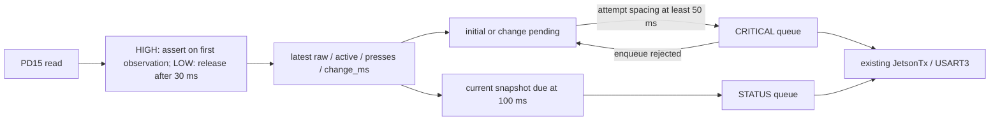

# PD15 emergency-stop telemetry v1

This change reports the physical button independently of motor power, ODOM and
recovery. It does not issue STOP, ENABLE or RESET, and does not modify existing
Drive/Lift recovery, TPDO gates or RGB behavior. Jetson/base-driver work is pending.

## Input and state

PD15 is INPUTF, MCU package pin 86 in the supplied schematic. Its use as the
emergency-stop feedback and polarity come from the hardware owner's confirmation:
the front end inverts the signal, so normal/unpressed is LOW and pressed is HIGH.
GPIO mode is input, no internal pull; the external front end must drive the pin.

Initialization follows GPIO and JetsonTx initialization. It samples immediately:
LOW starts inactive/count 0; HIGH starts active/count 1. No automatic baseline
learning. `EstopStatus_Update()` runs at startup and before JetsonTx service in
every main-loop iteration. It reads the pin once, with no EXTI and no ISR sending.



Every observed HIGH cancels an ongoing release timer. Release is confirmed after
30 ms of LOW samples without an intervening HIGH sample. Pulses wholly between
main-loop samples cannot be detected; debounce and sampling bounds require bench
verification. A brief LOW during release filtering produces `raw=0 active=1`.

## Wire contract

```text
ESTOP v=1 seq=42 t_ms=123456 raw=1 active=1 valid=1 presses=3 change_ms=123450\r\n
```

The displayed `\r\n` represents two actual CR/LF bytes. ASCII; no binary payload.
The global protocol remains 5. `v=1` versions only ESTOP.

| Field | Meaning |
| --- | --- |
| `seq` | uint32 enqueue-attempt number, starts at 1 each boot; rejected attempts leave gaps |
| `t_ms` | uint32 HAL tick at this GPIO observation; includes wrap after about 49.7 days |
| `raw` | instantaneous electrical level, 0 or 1 |
| `active` | confirmed logical state: 1 pressed; 0 released |
| `valid` | 1 once initialized and sampled; no frames emitted before initialization. Does not diagnose wire breaks, floating input or power health |
| `presses` | uint32 count of observed inactive-to-active transitions this boot, including a pressed startup; wraps modulo 2^32 |
| `change_ms` | uint32 tick of initialization or last confirmed logical-state change; release timestamp is confirmation time |

Initial/change snapshots use CRITICAL. Event attempts, including rejected retries,
are separated by at least 50 ms. Changes in that interval coalesce into the latest
state, with observed press count preserved; this is not an exact edge journal.
If CRITICAL is full, pending state stays set, and is re-formatted from the latest
sample on retry. No blocking wait, dynamic allocation, direct HAL UART call, or
unbounded queue is added. Periodic STATUS attempts occur every 100 ms; a successful
event enqueue resets that timer. A failed event does not suppress a due periodic
attempt. A failed periodic enqueue waits for the next period. No catch-up bursts.

Existing TX behavior still applies: STATUS drops its oldest queued frame on full;
CRITICAL rejects new frames on full. Enqueue success is not receipt confirmation:
UART errors may discard a frame, and strict higher priorities may delay STATUS.
Periodic repetition repairs current state, not guaranteed historical delivery.

## Future receiving side

CRITICAL can overtake an older STATUS snapshot. Within a known boot, accept a
sequence only if `delta = (uint32_t)(new_seq - last_seq)` satisfies
`0 < delta < 0x80000000`. Do not let duplicates/older frames extend freshness.
The newest raw/active/count fields must be processed as one snapshot. A press
counter increase with `active=0` means an observed press has since been released;
it does not provide the complete times/history of missed edges.

Suggest UNKNOWN after 500 ms without a fresh valid snapshot, subject to load
testing. UNKNOWN also applies on reconnect/reboot until a fresh session is
established. v1 has no boot ID: it cannot unambiguously distinguish all MCU resets
from delayed frames by sequence alone. A future base-driver integration must
handle that explicitly before using this as authoritative state. Current host
parsers ignore the new prefix; ROS/UI behavior has not been implemented here.

`active=1` identifies the asserted input. `active=0` does not prove recovery failed
or that motor power is present. Emergency-stop and recovery faults may coexist.
The legacy TPDO diagnostic `estop_active` remains its old control-gate placeholder;
it is not the physical PD15 status.

## UART budget and timing

USART3 is 460800 8N1: ten wire bits per byte, theoretical 46,080 bytes/s in each
direction. Longest ESTOP frame is 105 bytes including CRLF; wire time 2.279 ms.
At 10 Hz it adds at most 1,050 bytes/s, **2.28%** of PCB-to-Jetson line capacity.
Event attempts are capped at 20 Hz; the deliberately conservative combined
30 Hz budget is 3,150 bytes/s, **6.84%**, before queue rejection/coalescing. Stable
input has no continuing change-event traffic. There is no ACK traffic addition.

Existing nominal producers: IMU 100 Hz, ODOM/LIFT each 10 Hz, BAT 1 Hz, optionally
two health lines each 10 Hz. Assuming every old line were the maximum 192 bytes,
121-141 lines/s would use 50.42%-58.75%; adding periodic ESTOP gives
52.70%-61.03%. This is a conservative calculation, not a load measurement or a
full bound on debug/command bursts. Queue depth, CPU/ISR work and main-loop stalls
also matter. `UART_TX_DEBUG` exposes drop, high-water, busy, error and timeout
counters; compare before/after under the same robot workload.

An in-flight 192-byte frame takes 4.167 ms and cannot be preempted. Event delay
also includes GPIO sampling delay, up to 50 ms rate limiting during repeated
changes, queued CRITICAL traffic and any transport recovery. The loop's 1 ms
delay is not a 1 ms worst-case loop period; the separate 9600-baud battery
request alone can block around 8.3 ms. No hard end-to-end latency guarantee is
claimed from the arithmetic. Hardware emergency-stop action remains separate.

## Decisions and verification

Polling in the existing main loop avoids ISR/EXTI changes for a held mechanical
button. EXTI would be appropriate if minimum pulse capture/latency requirements
cannot be met by measured loop timing. Events plus periodic push were chosen for
prompt changes and recovery of current state; host polling would add request
traffic and require host changes now. Reusing ODOM was rejected because ODOM can
stop during feedback failure, exactly when this independent reason is needed.

Automated regression executes actual `estop_status.c` with fake GPIO and TX
enqueue: initialization, boot pressed, immediate assertion, release/bounce,
coalesced press/release, queue rejection and retry, periodic fallback, tick wrap,
main-loop stall and the real format's 105-byte maximum. The normal build requires
this test plus the existing Drive/Lift/PDO regressions and ARM compilation.

Hardware acceptance still required (not performed by those checks):

1. Measure PD15 LOW/HIGH and verify the front-end drive with no internal pull.
2. Verify MCU/front end/Jetson UART stay powered after the motor-power cut.
   If MCU loses power, firmware cannot guarantee a final serial report.
3. With the mechanism secured, observe startup pressed/released, repeated
   press/release and recovery failure; check independent ESTOP/ODOM behavior.
4. Record UART drop/high-water/error counters, existing stream rates and measured
   input-to-receive latency under peak operational/debug traffic.
5. Implement and validate Jetson sequence, freshness and reboot-session handling
   before exposing the state as authoritative in ROS/UI.
